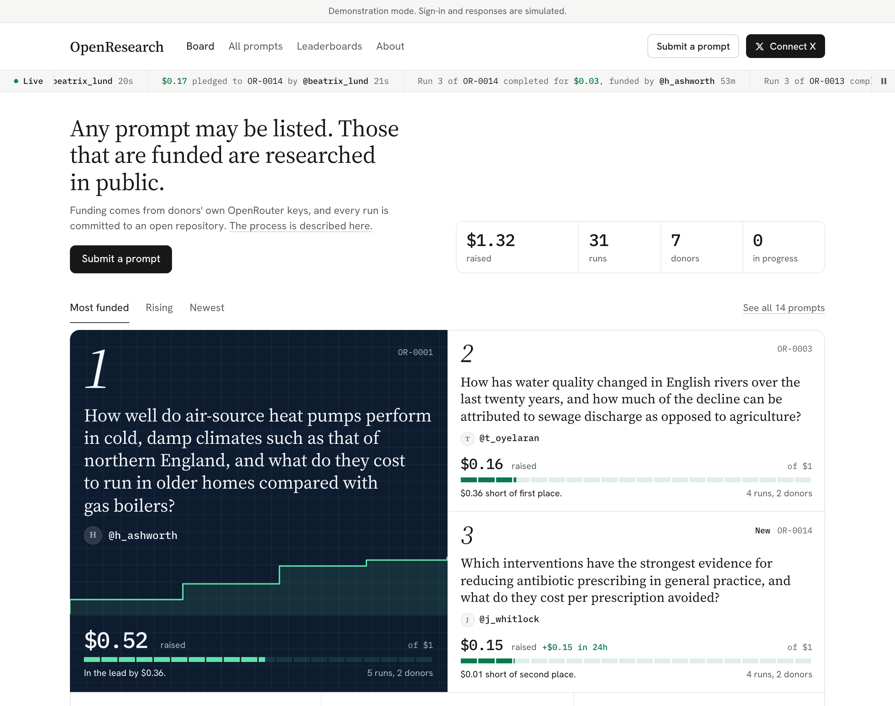

# OpenResearch

A public board of research prompts. Any prompt of up to 250 words may be listed by anyone with an X
account, and a public git repository is created for it. Research on that prompt is paid for by
whoever chooses to donate from their own OpenRouter key. Every run is committed to the repository as
text and as HTML. Projects and donors are ranked on two leaderboards, and shareable cards can be
generated for X.



- **[CLAUDE.md](CLAUDE.md)**: where the project stands and how it is to be worked on, for the next agent or person.
- **[docs/DEPLOY.md](docs/DEPLOY.md)**: putting it on a server, step by step.
- **[docs/LAUNCH.md](docs/LAUNCH.md)**: the launch checklist, the first real run, and the risks that remain.
- **[CONTRIBUTING.md](CONTRIBUTING.md)**: how a change is proposed, checked and merged. Security problems are reported as [SECURITY.md](SECURITY.md) says.

## Seeing it working

Node 22.17 or later and git are required. Nothing else is needed: no accounts, no keys, no money.

```sh
npm install
npm run demo
```

The site is opened in Chrome at <http://localhost:3000> with sample projects, once it is ready. The
default browser is used where Chrome is not installed, and `npm run demo -- --no-open` leaves the
browser alone. Sign-in and model responses are simulated by a stand-in server, and small donations
keep arriving so that the live parts of the page can be seen. Any handle may be used, and keys
beginning `sk-or-v1-capped` are accepted. Sample data is kept in `data-demo/`, which may be deleted at
any time.

## Running it properly

```sh
npm run setup      # creates .env with a new encryption key
npm run dev        # development, at http://localhost:5173
npm run build      # production build, for the address in ORIGIN
npm run preflight  # checks the configuration, and spends nothing
npm start          # production server, on the port in PORT
```

An X app is needed for sign-in, and [docs/DEPLOY.md](docs/DEPLOY.md) gives the steps. It must have
credit, because X refuses requests from an app without any. For a local test against real X, X's
documentation asks for `127.0.0.1` rather than `localhost`, so `ORIGIN` is set to
`http://127.0.0.1:3000` and `http://127.0.0.1:3000/auth/x/callback` is registered.

The site must run as a single long-lived process with a persistent disk, because the runs are carried
out by a worker inside it. Serverless hosting will not work.

## Moving it to another device

The folder is ready to be dragged to a USB drive as it stands. `node_modules`, the builds and the sample data have
been left out, because they can be rebuilt, and because `node_modules` holds programs specific to one kind of machine.
If they have been created again by working in the folder:

```sh
npm run clean      # removes node_modules and builds; data, data-demo and .env are kept
```

On the other device, the folder should be copied off the USB drive before it is used. macOS may add hidden `._` files
beside everything on such a drive. They are ignored by git and the test tools, and `find . -name '._*' -delete` removes them.

```sh
npm install
npm run demo       # or: npm run dev
```

If there is a `.env` or a `data/` folder, they hold the encryption key and everything that has been saved. They are
excluded from git and should be kept private. If `.env` is lost, stored OpenRouter keys can no longer be read and will
have to be added again. `data-demo/` holds only sample data, and it may be deleted at any time.

## The repository

The code is kept at <https://github.com/supersonicsines/openresearch>, and is obtained with:

```sh
git clone https://github.com/supersonicsines/openresearch.git
cd openresearch
npm install
```

`.gitignore` excludes `.env`, `data/`, `data-demo/`, `backups/`, `node_modules/` and all builds, so no keys or
saved data are ever committed.

## How it works

- **Stack.** SvelteKit 3 and Svelte 5 with plain CSS, on a single Node process. SQLite comes from
  `node:sqlite`, so there is no database to install, and changes to its structure are applied at
  startup. Repositories are ordinary git repositories in `data/repos/`. Share cards are drawn by Satori
  and resvg in WebAssembly, so there are no native modules to rebuild when moving between machines.
- **A run.** The next open question is taken and researched with web search through OpenRouter, with
  the output streamed to the page. The findings are then revised by the same model, and further
  questions are drawn up. The report and findings are committed as `.md` and `.html`, with the donor,
  model, tokens and cost recorded in the commit message. Runs on one project happen one at a time.
- **Budgets.** The most an attempt could cost is worked out in advance from the model's published
  prices, the size of the reply is limited accordingly, and that maximum is counted against the
  donation before the attempt starts. It is corrected to OpenRouter's reported figure afterwards.
  A donation closes when it has been spent, when no open questions remain, or after 40 runs. Reasoning
  is requested at low effort, because it comes out of the same allowance as the reply.
- **Keys.** Keys are checked with OpenRouter, encrypted with AES-256-GCM and bound to the account that
  added them. They never return to the browser. A key with no limit needs a separate acknowledgement.
- **Model output.** It is treated as hostile. It is sanitised before display, stripped of images and
  scripts, and the raw HTML files are served in a sandbox.
- **Live updates.** Open pages ask for recent activity every 8 seconds, and update without a reload.
  A run in progress is streamed to its project page. Public queries are cached until the next write,
  so a burst of visitors does not repeat them.
- **Moderation.** Prompts are published without review. Anyone may report a project, and `/admin`, for
  the handles in `ADMIN_HANDLES`, can remove or delete projects and suspend accounts.
- **Limits.** The word limit is the only rule on a prompt. There is also a flood limit per account,
  which is 20 prompts an hour by default and can be removed, and limits on expensive requests per
  visitor, listed in [docs/DEPLOY.md](docs/DEPLOY.md).
- **Identities.** Accounts are always shown by their @handle, in the mono face, through
  `src/lib/components/Handle.svelte`.
- **The demo animation.** The animation on the About page and on an empty home page is an authored
  illustration in `src/lib/stage`, built with the Stageshow kit. It is the only React on the site, and
  it is downloaded only where it is shown. `src/lib/stage/REHEARSAL.md` records how it was checked.
- **Cloning.** Each project can be cloned with `git clone <site>/git/<project>.git`. Access is
  read-only by design.

## Tests

```sh
npm test            # unit tests
npm run test:e2e    # browser tests, using the installed copy of Chrome
npm run check       # types
npm run qa:sweep    # reads every word on every page; the instructions are at the top of scripts/qa-sweep.mjs
```

The browser tests use stand-ins for OpenRouter and X, and spend nothing. If Chrome is not installed,
`npx playwright install chromium` is run and `PW_CHANNEL=` is set to an empty value.
`scripts/mock-openrouter.mjs` lists the failures that the stand-in can produce.

## Known limits

- The site has not yet been run against real OpenRouter inference or real X sign-in, only against
  stand-ins and a comparison with the live documentation. [docs/LAUNCH.md](docs/LAUNCH.md) gives the
  first real run, which takes about ten minutes.
- Prompts are not reviewed in advance, and everything generated is published under the site's name.
  Reports and removal are available, and should be expected to be used.
- Citations are not checked automatically. Findings are labelled as unreviewed.
- The amount of a donation is enforced by this site, not by OpenRouter. The credit limit on a key is the
  only protection that does not depend on this site, which is why the warning is so prominent.
- A run in progress when the server stops is abandoned. Its maximum cost stays counted against the
  donation, because it may have been charged, and the donation resumes on restart. Figures on a
  donor's account page can therefore run slightly above what OpenRouter actually charged.
- Leaderboards count only finished runs, at the cost OpenRouter reported.
- There is one server process and one SQLite file, which is sufficient for a launch but is not redundant.

## Licence

The code is released under the [MIT licence](LICENSE). The fonts in `assets/card-fonts/` are under the SIL Open Font
Licence 1.1, and their licences are kept beside them.
